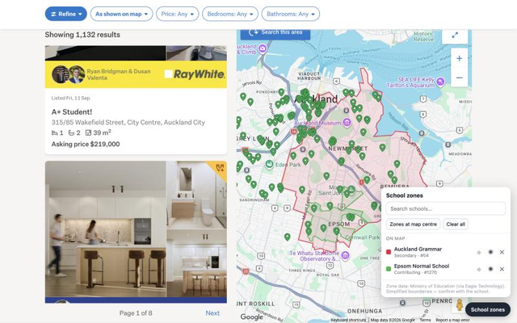

# School Zones for Trade Me

Chrome extension (Manifest V3, no build step) that draws NZ school enrolment zone
boundaries on the Trade Me property search map.

> Independent project — not affiliated with Trade Me Limited or the Ministry of Education.
> Boundaries are simplified for web display; always confirm zoning with the school.

## Install

1. Clone or download this repo
2. `chrome://extensions` → enable **Developer mode**
3. **Load unpacked** → select the repo folder
4. Open a Trade Me property search, switch to **Map view**, click **School zones** (bottom-right) or the toolbar icon

Works in Chrome, Brave and Edge.

## Features

- Search ~1.3k zoned schools by name (macron-insensitive), click to draw + zoom to zone
- **Zones at map centre** — point-in-polygon lookup of every zone covering the map centre
- Per-zone colour, show/hide, zoom-to, remove; selection persists across reloads

## How it works

| File | World | Role |
|---|---|---|
| `src/hook.js` | page `MAIN`, `document_start` | Captures Trade Me's `google.maps.Map` instance and draws zones on a separate `google.maps.Data` layer |
| `src/content.js` | isolated | Shadow-DOM UI, persistence (`chrome.storage.local`), messaging |
| `src/background.js` | service worker | All fetches to the zone FeatureServer (Trade Me's CSP blocks page-context fetches to arcgis.com) |

Map capture uses two paths, because Google Maps is lazy-loaded by the SPA and may
construct the map before our hook installs:

1. `google.maps.Map` is replaced with a `Proxy` whose `construct` trap records new instances.
2. `Map.prototype.getBounds/getCenter/getZoom/getProjection` are wrapped; Trade Me calls
   these on every idle/pan, so a pre-existing map is captured on first interaction.

The largest connected map is treated as the active one (re-evaluated every 1.5s to
survive SPA route changes). Hook ↔ content messages use `window.postMessage` with
`ns: "tmsz"`.

## Data

Zone polygons: Eagle Technology's ArcGIS Online republish of the Ministry of Education
enrolment zones —
`services.arcgis.com/XTtANUDT8Va4DLwI/arcgis/rest/services/NZ_School_Zone_boundaries/FeatureServer/0`
(fields: `OBJECTID`, `School_ID` = MoE institution number, `School_name`, `Institution_type`,
`Effective_date`). Some schools have several zone features (e.g. composite schools by year
range), so zones are keyed by `OBJECTID`, not `School_ID`.

- Source data © Ministry of Education (CC BY); the service is under Eagle's web-services
  terms and geometry is simplified — not authoritative. Check terms before publishing.
- Schools list cached 7 days in `chrome.storage.local`.

## Packaging

Store submission assets and form answers live in [`store/`](store/STORE_LISTING.md);
privacy policy: [`store/PRIVACY.md`](store/PRIVACY.md). Zip `manifest.json`, `src/` and `icons/` to upload.

## Known limitations / ideas

- Only schools *with* an enrolment scheme appear (unzoned schools have no polygon).
- `Institution_type` values are messy upstream ("Full Primay", "FullPrimary", …).
- Ideas: highlight listing pins inside selected zones (needs marker capture, similar hook
  on `google.maps.Marker`/`AdvancedMarkerElement`); right-click map → zones here;
  bundle a simplified GeoJSON snapshot for offline/robustness.

## License

Code: [MIT](LICENSE). Zone data is © Ministry of Education (CC BY) and is not covered by this licence.
